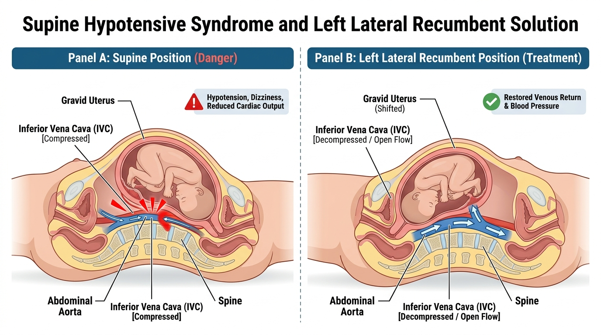
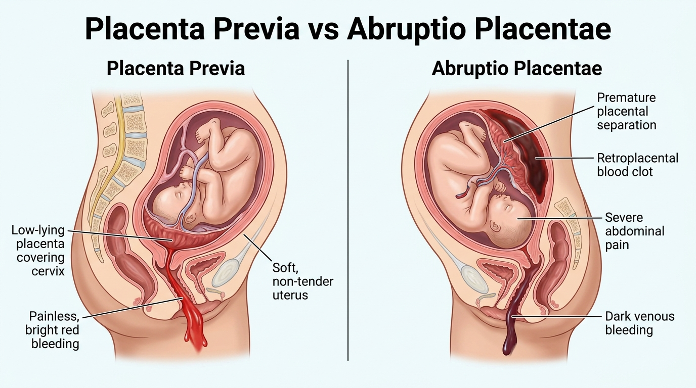
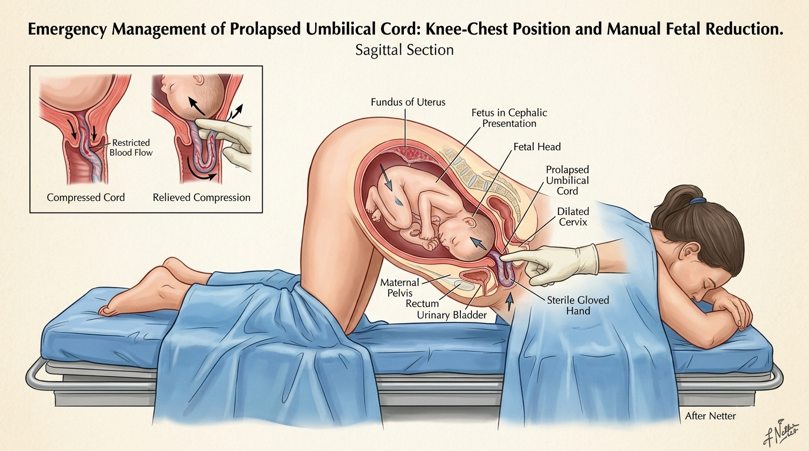

# KING COUNTY EMS TRAINING DIVISION — BLOCK #3 COMPREHENSIVE MASTER STUDY GUIDE
**Chapters Covered:**  
* **Chapter 20:** Endocrine & Hematologic Emergencies (pp. 777–802)  
* **Chapter 21:** Allergy & Anaphylaxis (pp. 803–820)  
* **Chapter 33:** Environmental Emergencies (pp. 1199–1240)  
* **Chapter 24:** Gynecologic Emergencies (pp. 881–897)  
* **Chapter 34:** Obstetrics & Neonatal Care (pp. 1242–1279)  
**Textbook Reference:** *Emergency Care and Transportation of the Sick and Injured (AAOS 12th Edition)*  
**Course Code:** KCEMS-7CDE86  

---

## TABLE OF CONTENTS
1. [MODULE 1: CHAPTER 20 — ENDOCRINE & HEMATOLOGIC EMERGENCIES](#module-1-chapter-20--endocrine--hematologic-emergencies)
2. [MODULE 2: CHAPTER 21 — ALLERGY & ANAPHYLAXIS](#module-2-chapter-21--allergy--anaphylaxis)
3. [MODULE 3: CHAPTER 33 — ENVIRONMENTAL EMERGENCIES](#module-3-chapter-33--environmental-emergencies)
4. [MODULE 4: CHAPTER 24 — GYNECOLOGIC EMERGENCIES](#module-4-chapter-24--gynecologic-emergencies)
5. [MODULE 5: CHAPTER 34 — OBSTETRICS & NEONATAL CARE](#module-5-chapter-34--obstetrics--neonatal-care)
6. [MODULE 6: MASTER 30-QUESTION ORAL EXAM & POP QUIZ HIT LIST](#module-6-master-30-question-oral-exam--pop-quiz-hit-list)

---

# MODULE 1: CHAPTER 20 — ENDOCRINE & HEMATOLOGIC EMERGENCIES

### I. Endocrine System Physiology & Glucose Metabolism
* **Endocrine Glands:** Ductless glands that secrete messenger hormones directly into the bloodstream to regulate cellular metabolism, growth, and fluid balance.
* **Cellular Metabolism:** Body cells require both **GLUCOSE** and **OXYGEN** to produce ATP through aerobic metabolism. While skeletal muscles and liver can temporarily burn fatty acids, the **BRAIN requires an uninterrupted, continuous supply of glucose**.
* **The Pancreatic Islets of Langerhans:**
  * **Alpha Cells:** Produce and secrete **GLUCAGON**. Glucagon stimulates the liver to convert stored glycogen into active circulating glucose (glycogenolysis), raising blood sugar.
  * **Beta Cells:** Produce and secrete **INSULIN**. Insulin acts as the cellular "key" that binds to cell membrane receptors, opening channels to allow glucose to enter and nourish cells.

### II. Diabetes Mellitus Type 1 & Diabetic Ketoacidosis (DKA)
* **Pathophysiology of Type 1 DM:** Autoimmune disorder in which the immune system produces antibodies against its own pancreatic beta cells, resulting in an **absolute deficiency of insulin**. Usually diagnosed in childhood or adolescence.
* **The Classic "3 P's" of New-Onset Type 1:**
  * **Polyuria:** Frequent, excessive urination caused by osmotic diuresis (glucose exceeds kidney filtration threshold [~180 mg/dL] and drags massive water into urine).
  * **Polydipsia:** Excessive, unquenchable thirst secondary to systemic volume depletion.
  * **Polyphagia:** Ravenous hunger because starved cellular tissues cannot take up the glucose trapped in the bloodstream.
* **Diabetic Ketoacidosis (DKA) Cascade:**
  1. Cells starve due to lack of insulin.
  2. The body begins rapidly burning **FAT** stores for cellular energy.
  3. Fat metabolism generates toxic acid waste products known as **KETONES** (acetoacetate and beta-hydroxybutyrate).
  4. Ketone accumulation causes severe metabolic ketoacidosis.
* **Hallmark Assessment Findings in DKA:**
  * Blood glucose usually **$> 400\text{ mg/dL}$**.
  * **Kussmaul Respirations:** Very deep, rapid, sighing respirations designed to blow off carbon dioxide (an acid) to compensate for metabolic ketoacidosis.
  * **Fruity / Sweet Acetone Breath Odor:** Volatile acetoacetate exhaled through the lungs.
  * Diffuse severe abdominal cramping, nausea, vomiting, body aches.
  * Warm, dry, flushed skin with poor turgor (dehydration).
  * Progressive lethargy, confusion, or coma.

> [!CAUTION]
> **Rookie DKA Trap:** Never mistake Kussmaul respirations for hyperventilation syndrome or asthma. The deep sighing respirations are the body's emergency physiological defense to blow off carbonic acid!

### III. Diabetes Mellitus Type 2 & HHNS
* **Pathophysiology of Type 2 DM:** Caused by cellular insulin resistance paired with progressive secretory defects. Strongly correlated with obesity and sedentary lifestyle.
* **Hyperosmolar Hyperglycemic Nonketotic Syndrome (HHNS / HHS):**
  * Develops in Type 2 diabetics when severe hyperglycemia (**BGL 600–1000+ mg/dL**) drives massive osmotic water loss.
  * **Why No Ketoacidosis?** Type 2 diabetics have *just enough* endogenous insulin to prevent massive lipolysis and ketone formation. Therefore, **Kussmaul breathing and fruity breath DO NOT OCCUR in HHNS**.
  * **Clinical Presentation:** Profound dehydration (sunken eyes, tenting skin), normal or shallow respirations, tachycardia, hypotension, and marked lethargy or coma.

### IV. Hypoglycemic Crisis (Insulin Shock)
* **Pathophysiology:** Blood glucose falls rapidly below **$60\text{ mg/dL}$** (most commonly when an insulin-dependent diabetic injects insulin but skips a meal or engages in vigorous exertion).
* **The Adrenaline Surge (Sympathetic Response):**
  * When the brain senses glucose deprivation, it triggers a massive sympathetic epinephrine dump.
  * Skin signs: **Cool, pale, and profusely diaphoretic (soaked in cold sweat)**.
  * Vitals: Tachycardia (HR > 110 bpm), tremors, agitation, dilated pupils.
* **The Stroke Mimic (Neuroglycopenia):**
  * Severe hypoglycemia starves the cortical motor strip, causing focal neurological signs: unilateral facial droop, slurred speech, and hemiplegia identical to an acute CVA.
  * **The Mandatory Rule:** ALWAYS check a fingerstick BGL on any patient exhibiting stroke symptoms or altered mental status!
* **Oral Glucose Protocol:**
  * **Dose:** 15 to 30 grams (1 to 2 commercial tubes) administered buccally between the cheek and gum.
  * **Prerequisites:** Patient MUST be conscious, with a patent airway, intact gag reflex, and able to control their airway and swallow!
  * **Unresponsive Patient:** Position left lateral recumbent, open airway, request ALS for IV $D_{10}W$ (Dextrose 10%) or IM Glucagon.

### V. Hematologic Emergencies
* **Sickle Cell Disease:**
  * Autosomal recessive genetic disorder causing abnormal hemoglobin S. Under hypoxic or dehydrated stress, red blood cells become crescent/sickle-shaped, rigid, and sticky.
  * **Vaso-Occlusive Crisis:** Sickled cells lodge in microvascular beds, causing localized ischemia and agonizing pain in joints, back, chest, and abdomen.
  * **Complications:** Acute chest syndrome, stroke, priapism, and jaundice.
  * **EMT Management:** High-flow $O_2$, maintain body warmth, gentle handling, and rapid transport. Never apply ice packs!
* **Hemophilia:** Inherited genetic deficiency of clotting factors (Factor VIII in Hemophilia A; Factor IX in Hemophilia B). Patients cannot form stable fibrin clots; minor blunt trauma causes massive, uncontrolled internal bleeding into joint capsules (**hemarthrosis**) or the cranial vault.
* **Thrombophilia & DVT:** Hypercoagulable state predisposing to abnormal intravascular blood clots. Deep Vein Thrombosis (DVT) in the lower extremities can dislodge and travel to the pulmonary arterial bed, creating a fatal **Pulmonary Embolism (PE)**.

---

# MODULE 2: CHAPTER 21 — ALLERGY & ANAPHYLAXIS

### I. Immunology & The Anaphylactic Cascade
* **Sensitization:** Initial exposure to an allergen creates antigen-specific **IgE antibodies** that coat the surface of tissue mast cells and circulating basophils.
* **Secondary Exposure & Mast Cell Degranulation:** Subsequent allergen exposure cross-links adjacent IgE antibodies, triggering immediate, violent degranulation of mast cells and systemic dumping of chemical mediators: **HISTAMINE**, leukotrienes, and prostaglandins.
* **Triad of Histamine Action:**
  1. **Systemic Vasodilation:** Peripheral vascular beds dilate wide open $\rightarrow$ distributive shock and profound hypotension.
  2. **Capillary Permeability:** Vascular walls become porous, leaking fluid into interstitial spaces $\rightarrow$ widespread angioedema, urticaria, and laryngeal edema.
  3. **Bronchial Smooth Muscle Spasm:** Lower airways constrict tightly $\rightarrow$ severe bronchospasm and wheezing.

### II. Clinical Hallmarks & Assessment
* **Most Common Triggers:**
  * **#1 cause of anaphylaxis deaths:** **FOODS** (peanuts, tree nuts, shellfish) account for $30\%$ of all anaphylactic fatalities.
  * **#2 cause:** Medications (penicillin, cephalosporins).
  * **#3 cause:** Insect stings (hymenoptera venom: bees, wasps, hornets).
* **Airway Sounds:**
  * **Inspiratory Stridor:** Harsh, high-pitched crowing at the neck $\rightarrow$ indicates **laryngeal edema (upper airway swelling)**. This is the **most reliable clinical indicator of imminent upper airway closure**!
  * **Expiratory Wheezing:** High-pitched musical whistling $\rightarrow$ lower airway bronchospasm.
* **Skin Findings:** **Urticaria (hives)**—raised, intensely itchy erythematous dermal plaques; **Angioedema**—deep swelling of lips, tongue, uvula, and periorbital tissue.
* **Biphasic Reactions:** Recurrence of life-threatening anaphylactic symptoms **1 to 8 hours (or up to 72 hours)** after the initial episode has completely resolved, without any repeat allergen exposure! All anaphylaxis patients require hospital observation.

### III. Epinephrine Pharmacology & Administration Protocol
* **Receptor Profile:**
  * **Alpha-1:** Powerful peripheral vasoconstriction $\rightarrow$ raises blood pressure, reverses distributive shock, and shrinks mucosal edema in the upper airway.
  * **Beta-1:** Increases cardiac contractility and heart rate.
  * **Beta-2:** Potent bronchodilation $\rightarrow$ opens constricted lower airways.
* **Standard Dosing:**
  * **Adult Auto-Injector:** **0.30 mg** of $1:1,000$ epinephrine IM (patients $> 30\text{ kg} / 66\text{ lbs}$).
  * **Pediatric Auto-Injector:** **0.15 mg** of $1:1,000$ epinephrine IM (patients $15\text{ to } 30\text{ kg} / 33\text{ to } 66\text{ lbs}$).
* **Injection Technique:** Administer into the **anterolateral thigh** (midway between hip and knee). Push firmly until mechanism clicks; **HOLD FIRMLY IN PLACE FOR 3 SECONDS**.
* **Bee Stinger Removal:** **SCRAPE** the stinger off with a rigid card. Never squeeze with tweezers (squeezing compresses the attached venom sac and pumps more venom into the patient).
* **The Inadequate Breathing Rule:** If a patient in anaphylaxis exhibits cyanosis, stridor, and altered LOC, **ventilate with a Bag-Valve-Mask (BVM) and high-flow $O_2$ first** while the partner prepares the epinephrine!

---

# MODULE 3: CHAPTER 33 — ENVIRONMENTAL EMERGENCIES

### I. Thermoregulation & The 5 Heat Loss Mechanisms
1. **Conduction:** Direct transfer of heat via physical contact with a colder solid object (e.g., lying on snow or concrete). *Heat loss in cold water occurs **25 times faster** than in cold air!*
2. **Convection:** Heat lost to circulating air or liquid currents moving across the skin (wind chill).
3. **Evaporation:** Conversion of liquid perspiration to vapor.
4. **Radiation:** Direct loss of radiant heat energy into surrounding space (uncovered head/neck).
5. **Respiration:** Exhaling warm, humidified air and inhaling cold ambient air.

### II. Systemic Hypothermia
* **Definition:** Core body temperature $< 95^\circ\text{F}$ ($35^\circ\text{C}$).
* **Mild Hypothermia ($93.2^\circ\text{F} \text{ to } 98^\circ\text{F}$):** Shivering is active and violent. Tachycardia and tachypnea present.
* **Moderate Hypothermia ($86^\circ\text{F} \text{ to } 93.2^\circ\text{F}$):** **SHIVERING STOPS COMPLETELY.** Muscle activity ceases, apathy sets in, and mental status rapidly deteriorates.
* **Severe Hypothermia ($< 86^\circ\text{F}$):**

> [!CAUTION]
> **LETHAL HYPOTHERMIA TRAP: VENTRICULAR FIBRILLATION**  
> At core temperatures below $86^\circ\text{F}$, the myocardium becomes extraordinarily irritable and electrically unstable. **Rough handling, sudden jarring, vigorous movement, or rapid log-rolling can instantly trigger fatal VENTRICULAR FIBRILLATION (V-Fib)!** Handle the patient with extreme gentleness.

* **Pulse Check Duration:** Check the carotid pulse for a full **30 to 45 seconds** before deciding the patient is in cardiac arrest!
* **Resuscitation Directive:** *"A patient is not dead until they are warm and dead!"*

### III. Local Cold Injuries
* **Frostnip:** Superficial chilling of skin without cellular freezing (ears, nose, fingers). Blanching and numbness; rewarms readily.
* **Immersion Foot (Trench Foot):** Prolonged cold, wet water exposure over days without freezing. Wrinkled, pale, numb, macerated tissue.
* **Frostbite:** Tissues are actually frozen, with ice crystals permanently destroying cellular walls. Hard, waxy, frozen, numb feel. Can progress to gangrene.
* **Rewarming Protocol:** Never rewarm if there is ANY chance of refreezing before reaching hospital! Never rub or massage. If field rewarming is necessary, immerse in warm water bath maintained at **$102^\circ\text{F} \text{ to } 104^\circ\text{F}$ ($38.9^\circ\text{C} \text{ to } 40^\circ\text{C}$)**.

### IV. Heat-Related Illnesses
* **Heat Cramps:** Involuntary, painful skeletal muscle spasms from sodium and water loss during heavy exertion.
* **Heat Exhaustion:** Hypovolemia and vasodilation. Hallmarks: Profuse diaphoresis, cool/pale/clammy skin, dizziness, weakness, nausea, and **NORMAL MENTAL STATUS**.
* **Heat Stroke (Life-Threatening):** Complete failure of thermoregulatory mechanisms; core temp **$> 104^\circ\text{F}$ ($40^\circ\text{C}$)**. Hallmarks: **ALTERED MENTAL STATUS (confusion, delirium, seizures, coma)**. Skin can be hot/dry OR hot/moist (in exertional heat stroke).
* **Treatment Priority:** **IMMEDIATE ACTIVE RAPID COOLING TAKES PRECEDENCE OVER TRANSPORT!** Ice water immersion or ice packs to neck, axillae, and groin with vigorous fanning must be started immediately on scene.

### V. Diving, Altitude & Lightning Emergencies
* **Arterial Gas Embolism (Air Embolism / AGE):** Caused by breath-holding during ascent from a scuba dive. Alveolar rupture forces air bubbles into pulmonary veins $\rightarrow$ cerebral circulation. **ONSET IS IMMEDIATE UPON SURFACING:** Sharp chest pain, dyspnea, hemoptysis, and stroke-like hemiplegia.
* **Decompression Sickness ("The Bends"):** Nitrogen bubbles emerge from tissue solution **HOURS after diving**. Deep joint pain, abdominal cramping, and mottling. Treatment: High-flow $O_2$, left lateral recumbent, hyperbaric chamber transport.
* **High Altitude Pulmonary Edema (HAPE):** Occurs at elevations $> 8,000\text{--}10,000\text{ ft}$. Severe dyspnea at rest, pink frothy sputum, cyanosis, and crackles. Treatment: Immediate descent to lower altitude and high-flow $O_2$.
* **Lightning Strike "Reverse Triage":** In a lightning mass-casualty incident, **treat pulseless and apneic patients FIRST**. The massive electrical current causes temporary cardiac asystole and respiratory paralysis; the heart often spontaneously restarts, but prolonged respiratory arrest leads to secondary fatal anoxia. Providing immediate BVM ventilations saves lives.

---

# MODULE 4: CHAPTER 24 — GYNECOLOGIC EMERGENCIES

### I. Female Reproductive Anatomy & Normal Cycle
* **Ovaries:** Female gonads; produce estrogen and progesterone and release one mature ovum every 28 days.
* **Fallopian Tubes:** Muscular tubes connecting ovaries to uterus. **Normal fertilization occurs in the OUTER THIRD OF THE FALLOPIAN TUBE.**
* **Uterus:** Muscular organ where fertilized egg implants in the endometrium.
* **Cervix:** Lower narrow neck of uterus opening into vagina.
* **Vagina:** Muscular birth canal.

### II. Pelvic Inflammatory Disease (PID)
* **Pathophysiology:** Ascending infection of upper female reproductive tract originating from lower genital tract. Primarily caused by STIs: *Chlamydia trachomatis* and *Neisseria gonorrhoeae*.
* **Hallmark Assessment Findings:** Dull, progressive lower abdominal and pelvic pain that worsens with walking; foul-smelling yellow/green vaginal discharge; low-grade fever.
* **The "PID Shuffle":** Patient walks bent forward with short, shuffling steps to minimize peritoneal jarring.
* **Long-Term Hazard:** Tubal scarring causes chronic pelvic pain, infertility, and a massive increased risk of **ECTOPIC PREGNANCY**.

### III. Non-Traumatic Vaginal Bleeding
* **The Golden Rule:** **NEVER pack dressings, gauze, or tampons inside the vagina under any circumstances!**
* **Field Management:** Apply external sterile sanitary pads over perineum. Count soaked pads per hour ($> 1\text{ pad/hour}$ indicates significant hemorrhage). Treat for hypovolemic shock.

### IV. Sexual Assault Protocols & Forensic Evidence Preservation
* **Medical Priorities First:** Treat life-threatening bleeding and airway compromise before evidence collection.
* **The Paper Bag Rule:** Place all collected clothing and physical evidence in separate, clean **BROWN PAPER BAGS**. NEVER use plastic bags (condensation breeds bacterial mold that degrades DNA evidence!).
* **Patient Care Restrictions:** Discourage showering, bathing, douching, brushing teeth, washing hands, or urinating prior to forensic examination. Transport to a designated SANE-capable facility.

---

# MODULE 5: CHAPTER 34 — OBSTETRICS & NEONATAL CARE

### I. Maternal Physiology & Pregnancy Terminology
* **Blood Volume Expansion:** Maternal blood volume increases by **$40\% \text{ to } 50\%$**. Resting heart rate increases by 10 to 15 bpm. **A pregnant patient can lose up to $35\%$ of blood volume before showing signs of shock!**
* **Aspiration Vulnerability:** Relaxed gastroesophageal sphincter + slowed gastric motility = **all pregnant patients are considered to have a full stomach**.
* **Gravida / Para:** Gravida = total number of pregnancies; Para = viable deliveries past 20 weeks gestation.

### II. Supine Hypotensive Syndrome
* **Mechanism:** In the 3rd trimester ($> 20\text{ weeks}$), lying flat on the back causes the heavy gravid uterus to compress the **INFERIOR VENA CAVA (IVC)** against the spine, halting venous blood return to the heart.
* **Symptoms:** Dizziness, pallor, cold clammy sweat, tachycardia, and profound hypotension.
* **Management:** **Always transport pregnant patients in the LEFT LATERAL RECUMBENT position.**

### III. Hypertensive Disorders of Pregnancy
* **Gestational Hypertension:** BP $\ge 140/90\text{ mmHg}$ after 20 weeks gestation without proteinuria.
* **Preeclampsia:** Hypertension ($\ge 140/90$) + dependent facial/hand edema + proteinuria. Signs: severe frontal headache, visual changes (scotoma), epigastric pain.
* **Eclampsia:** Onset of generalized tonic-clonic **SEIZURES** or coma in a preeclamptic patient. Management: open airway, left lateral position, high-flow $O_2$, dim lights/sirens off, rapid ALS for IV Magnesium Sulfate.

### IV. The Three Stages of Labor
1. **Stage 1 (Dilation Phase):** Begins with regular contractions and ends with **FULL CERVICAL DILATION ($10\text{ cm}$)**. Longest stage; amniotic sac typically ruptures.
2. **Stage 2 (Expulsion Phase):** Begins with complete dilation and ends with **DELIVERY OF THE BABY**. Active pushing stage; crowning occurs.
3. **Stage 3 (Placental Phase):** Begins after infant delivers and ends with **DELIVERY OF THE PLACENTA** ($5\text{ to } 30\text{ minutes}$). Never pull on the cord!

### V. Field Delivery Assessment & Step-by-Step Procedure
* **Imminent Delivery Signs:** Contractions $< 2\text{ minutes}$ apart lasting 60–90 seconds; urge to push or have bowel movement; **CROWNING** visible at vaginal opening $\rightarrow$ Prepare to deliver on scene immediately!
* **Step-by-Step Delivery:**
  1. **Support Perineum & Head:** Gentle flat-palm pressure against crowning head to prevent explosive delivery and perineal tearing.
  2. **Check for Nuchal Cord:** Feel around neck for umbilical cord. Slip loop over baby's head. If too tight, clamp twice and cut between clamps immediately.
  3. **Suction Airway:** Suction mouth first, then nose with bulb syringe ($M$ before $N$) if secretions obstruct airway.
  4. **Deliver Shoulders:** Guide head gently downward for anterior shoulder, then upward for posterior shoulder.
  5. **Clamp & Cut Cord:** Wait 30–60s. Clamp 1st clamp 6 to 8 inches from baby; clamp 2nd clamp 2 to 4 inches further out. Cut between clamps.
  6. **Postpartum Hemorrhage ($> 500\text{ mL}$):** Firm circular **FUNDAL MASSAGE** of the top of the uterus to clamp bleeding arterioles. Encourage immediate breastfeeding.

### VI. Abnormal Deliveries & Obstetric Emergencies

* **Placenta Previa:** Placenta covers cervical opening. Hallmarks: **PAINLESS**, bright red vaginal bleeding in 3rd trimester. Uterus is soft and non-tender.
* **Abruptio Placentae:** Premature separation of placenta from uterine wall. Hallmarks: **SEVERE TEARING PAIN**, dark venous bleeding, and a **RIGID, board-like abdomen**.
* **Ectopic Pregnancy:** Embryo implants in fallopian tube; ruptures at 6 to 8 weeks. Hallmarks: Sudden sharp unilateral lower quadrant pain, missed menstrual period, syncope, **Kehr's sign (referred shoulder pain)**, and hemorrhagic shock.
* **Prolapsed Umbilical Cord (True Emergency):**

  * **ACTION 1:** DO NOT PUSH CORD BACK IN.
  * **ACTION 2:** Insert sterile gloved fingers into vagina and **physically push presenting fetal head UPWARD away from cord**.
  * **ACTION 3:** **MAINTAIN HAND ELEVATION CONTINUOUSLY** until surgeon takes over in the Operating Room!
  * **ACTION 4:** Mother in **KNEE-CHEST position** (hips elevated). Wrap cord in moist sterile dressing. Code 3 transport!
* **Breech Presentation (Butt or Feet First):** If head is trapped: Insert gloved hand and form a **"V" with fingers over infant's mouth and nose** to establish an airway space against vaginal wall.
* **Limb Presentation:** CANNOT deliver in field! Do not pull. Place mother in knee-chest position, cover limb with moist dressing, rapid transport.

### VII. Neonatal Resuscitation Algorithm & APGAR Matrix
1. **Initial 30 Seconds:** Dry thoroughly, keep warm, position airway, suction mouth then nose (if obstructed), stimulate by flicking soles or rubbing back.
2. **Heart Rate 60 to 100 bpm (or apneic/gasping):** Begin **BVM ventilations at 40 to 60 breaths/min** using room air ($21\% \text{ } O_2$) for 30 seconds.
3. **Heart Rate $< 60\text{ bpm}$ (despite 30s of BVM):** **START CHEST COMPRESSIONS IMMEDIATELY!** Ratio: **3:1** (90 compressions to 30 ventilations = 120 events/min). Switch to $100\%$ high-flow $O_2$.

| Category | 0 Points | 1 Point | 2 Points |
| :--- | :--- | :--- | :--- |
| **A** — Appearance | Blue/pale all over | Body pink, blue hands/feet (Acrocyanosis) | Completely pink |
| **P** — Pulse | Absent | $< 100\text{ bpm}$ | $> 100\text{ bpm}$ |
| **G** — Grimace | No response | Grimace / weak cry | Vigorous cry / sneeze |
| **A** — Activity | Limp, flaccid | Some flexion | Active motion |
| **R** — Respiration | Absent | Slow, irregular | Strong, vigorous cry |

---

# MODULE 6: MASTER 30-QUESTION ORAL EXAM & POP QUIZ HIT LIST

1. **Q: What hormone is produced by pancreatic alpha cells?**  
   *A: Glucagon (stimulates glycogenolysis in the liver).*
2. **Q: What hormone is produced by pancreatic beta cells?**  
   *A: Insulin (cellular key for glucose uptake).*
3. **Q: What is the classic triad of new-onset Type 1 Diabetes?**  
   *A: Polyuria, Polydipsia, and Polyphagia.*
4. **Q: What breathing pattern is characteristic of DKA?**  
   *A: Kussmaul respirations (rapid, deep, sighing).*
5. **Q: Why does a DKA patient’s breath smell fruity or like acetone?**  
   *A: Exhalation of volatile ketone bodies from fat metabolism.*
6. **Q: What skin signs define a hypoglycemic crisis?**  
   *A: Cool, pale, and profusely diaphoretic (soaked in cold sweat).*
7. **Q: What are the strict prerequisites to administer oral glucose?**  
   *A: Conscious, intact gag reflex, able to control airway and swallow.*
8. **Q: What is the primary cause of pain in a sickle cell crisis?**  
   *A: Vaso-occlusive microvascular sludging of rigid, crescent-shaped RBCs.*
9. **Q: What is the #1 food trigger of lethal anaphylaxis in young adults?**  
   *A: Peanuts and shellfish (cause 30% of anaphylaxis fatalities).*
10. **Q: What is the most reliable clinical indicator of upper airway laryngeal edema in anaphylaxis?**  
    *A: Inspiratory stridor heard at the neck.*
11. **Q: What is the adult epinephrine auto-injector dose and concentration?**  
    *A: 0.30 mg of 1:1,000 IM.*
12. **Q: What is the pediatric epinephrine auto-injector dose?**  
    *A: 0.15 mg of 1:1,000 IM (15 to 30 kg).*
13. **Q: How long must an EpiPen be held firmly against the lateral thigh?**  
    *A: 3 seconds.*
14. **Q: How should a bee or hornet stinger be removed from the skin?**  
    *A: Scraped off with a rigid card (never pinched with tweezers).*
15. **Q: What is a biphasic anaphylactic reaction?**  
    *A: Recurrence of severe symptoms 1 to 8 hours post-resolution without re-exposure.*
16. **Q: Heat loss in cold water occurs how much faster than in cold air?**  
    *A: 25 times faster via conduction.*
17. **Q: What single clinical finding differentiates Heat Stroke from Heat Exhaustion?**  
    *A: Altered mental status / central nervous system dysfunction (confusion, seizures, coma).*
18. **Q: What is the primary treatment for Heat Stroke on scene?**  
    *A: Immediate active rapid cooling (ice bath/ice packs to neck, axillae, groin) before transport.*
19. **Q: What physical sign marks the transition into Moderate Hypothermia (< 93.2°F)?**  
    *A: Shivering stops completely.*
20. **Q: Why must patients with severe hypothermia (< 86°F) be handled with extreme gentleness?**  
    *A: Rough handling easily converts an irritable myocardium into fatal Ventricular Fibrillation (V-Fib).*
21. **Q: How long must you check a carotid pulse on a hypothermic patient before starting CPR?**  
    *A: A full 30 to 45 seconds.*
22. **Q: What diving emergency occurs immediately upon surfacing with sharp chest pain and stroke signs?**  
    *A: Arterial Gas Embolism (Air Embolism / AGE) from breath-holding.*
23. **Q: What triage rule is applied in lightning mass-casualty incidents?**  
    *A: Reverse Triage (resuscitate cardiac and respiratory arrest victims first).*
24. **Q: Where does normal fertilization occur in the female reproductive system?**  
    *A: In the outer third of the Fallopian tube.*
25. **Q: What long-term hazard results from untreated Pelvic Inflammatory Disease (PID)?**  
    *A: Tubal scarring leading to high risk of Ectopic Pregnancy and infertility.*
26. **Q: How must physical clothing evidence from a sexual assault be packaged?**  
    *A: In individual, separate clean PAPER bags (never plastic).*
27. **Q: What vessel is compressed in Supine Hypotensive Syndrome, and how is it treated?**  
    *A: The Inferior Vena Cava (IVC); treated by Left Lateral Recumbent positioning.*
28. **Q: What clinically differentiates Placenta Previa from Abruptio Placentae?**  
    *A: Previa = PAINLESS bright red bleeding; Abruptio = PAINFUL dark bleeding with a rigid board-like abdomen.*
29. **Q: What are your immediate actions for a Prolapsed Umbilical Cord?**  
    *A: Never push cord in; insert sterile gloved fingers to push baby's head UP off cord, knee-chest position, Code 3 transport!*
30. **Q: In neonatal resuscitation, what heart rate triggers chest compressions, and at what ratio?**  
    *A: Heart rate < 60 bpm despite 30s of BVM; ratio is 3:1 (90 compressions to 30 ventilations).*
