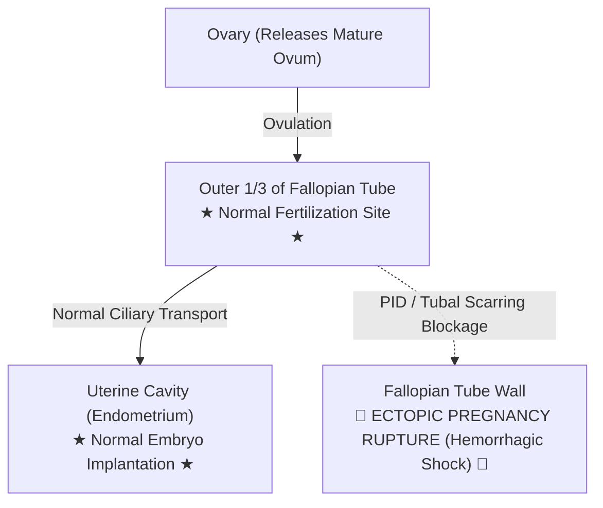
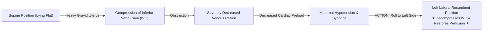
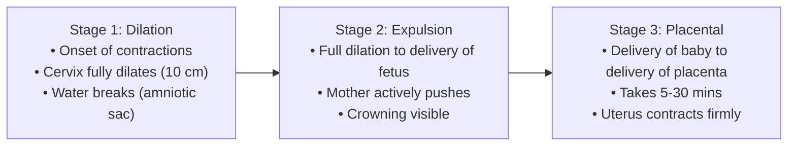
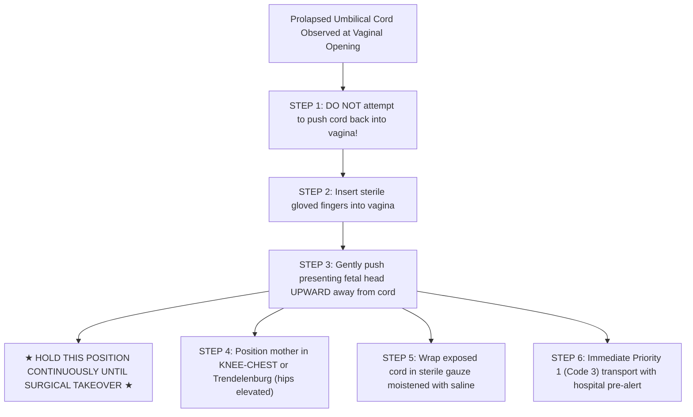
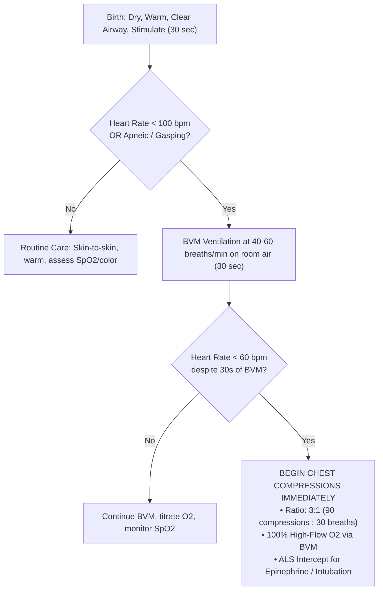

# KING COUNTY EMS TRAINING DIVISION — LECTURE NOTES & STUDY GUIDE
**Block #3 Lecture: Thursday, October 22, 2026 (18:00 – 22:00 hrs)**  
**Textbook Reference:** *Emergency Care and Transportation of the Sick and Injured (AAOS 12th Ed.)*  
**Chapters Covered:**  
* **Chapter 24:** Gynecologic Emergencies (pp. 881–897)  
* **Chapter 34:** Obstetrics & Neonatal Care (pp. 1242–1279)  

---

## TABLE OF CONTENTS
1. [SECTION 1: CHAPTER 24 — GYNECOLOGIC EMERGENCIES](#section-1-chapter-24--gynecologic-emergencies)
   - Anatomy & Physiology Review
   - Pelvic Inflammatory Disease (PID)
   - Non-Traumatic Vaginal Bleeding
   - Special Protocol: Sexual Assault & Forensic Preservation
2. [SECTION 2: CHAPTER 34 — OBSTETRIC CARE & NORMAL DELIVERY](#section-2-chapter-34--obstetric-care--normal-delivery)
   - Anatomy & Physiology of Pregnancy
   - Gravida / Para Terminology
   - Supine Hypotensive Syndrome
   - Hypertensive Disorders of Pregnancy (Preeclampsia & Eclampsia)
   - The Three Stages of Labor
   - Determining Imminent Delivery (Stay & Deliver vs. Load & Go)
   - Step-by-Step Field Delivery Procedure
   - Postpartum Care & Management of Postpartum Hemorrhage
3. [SECTION 3: ABNORMAL DELIVERIES & OBSTETRICAL EMERGENCIES](#section-3-abnormal-deliveries--obstetrical-emergencies)
   - Placenta Previa vs. Abruptio Placentae
   - Ectopic Pregnancy
   - Nuchal Cord Management
   - Prolapsed Umbilical Cord
   - Breech Delivery vs. Limb Presentation
   - Meconium Staining
4. [SECTION 4: NEONATAL ASSESSMENT & RESUSCITATION](#section-4-neonatal-assessment--resuscitation)
   - The Golden Minute: Initial Newborn Steps
   - The Neonatal Inverted Resuscitation Pyramid
   - Heart Rate Cutoffs: The Rule of 60 and 100
   - APGAR Scoring System Matrix
5. [SECTION 5: INSTRUCTOR ORAL EXAM & POP QUIZ HIT LIST](#section-5-instructor-oral-exam--pop-quiz-hit-list)

---

# SECTION 1: CHAPTER 24 — GYNECOLOGIC EMERGENCIES

### I. Anatomy & Physiology Review
* **Ovaries:** Primary female sex glands; produce hormones (estrogen, progesterone) and release mature ovum every 28 days (ovulation).
* **Fallopian Tubes:** Muscular tubes connecting ovaries to uterus. **Fertilization occurs in the outer third of the fallopian tube.**
* **Uterus:** Muscular, hollow, pear-shaped organ where fertilized egg implants and fetus develops.
* **Cervix:** Lower narrow portion of the uterus opening into the vagina. Produces mucous plug during pregnancy.
* **Vagina:** Muscular canal extending from cervix to the exterior; serves as the birth canal.
* **Perineum:** Muscular area between vaginal opening and anus.

#### 🔬 Reproductive Pathway & Ectopic Risk Diagram:

---

### II. Pelvic Inflammatory Disease (PID)
* **Pathophysiology:** Infection of upper female reproductive tract (uterus, fallopian tubes, ovaries) originating from lower genital tract. Usually caused by sexually transmitted infections (STIs)—primarily *Chlamydia trachomatis* and *Neisseria gonorrhoeae*.
* **Hallmark Assessment Findings:**
  * Dull, aching, progressive lower abdominal and pelvic pain (bilateral).
  * Pain exacerbated during walking or sexual intercourse.
  * **The "PID Shuffle":** Patient walks bent forward with short, shuffling, hesitant steps to avoid peritoneal jarring.
  * Foul-smelling, yellow/greenish vaginal discharge.
  * Low-grade fever, chills, nausea, vomiting.
* **Complications:** Tubal scarring, chronic pelvic pain, and **massively increased risk of future ectopic pregnancy** or infertility.
* **EMT Field Management:**
  * Position of comfort (knees flexed).
  * Assess for signs of sepsis (fever + tachycardia + hypotension).
  * Gentle transport; do NOT perform internal pelvic examinations.

---

### III. Non-Traumatic Vaginal Bleeding
* **Potential Causes:** Spontaneous abortion (miscarriage), ectopic pregnancy, cervical polyps, uterine fibroids, trauma.
* **EMT Management Rules:**
  * **Rule 1:** NEVER insert anything into the vagina (tampons, packs, fingers).
  * **Rule 2:** Apply external sterile sanitary pads over the perineum to absorb blood.
  * **Rule 3:** Quantify blood loss by counting the number of soaked sanitary pads per hour (e.g., $> 1\text{ pad/hour}$ indicates significant hemorrhage).
  * Treat for hypovolemic shock if signs of hypoperfusion present: high-flow $O_2$, maintain body warmth, elevate legs or supine, rapid transport.

---

### IV. Special Protocol: Sexual Assault & Forensic Preservation
* **Provider Mindset:** Provide compassionate, non-judgmental care while strictly preserving legal physical evidence.
* **Crucial Guidelines:**
  * **Medical Life Threats First:** Control external bleeding and manage airway/breathing before evidence considerations.
  * **Preserve Clothing in PAPER Bags:** Place each article of clothing in **separate, clean brown paper bags**. Never use plastic bags (condensation/moisture breeds mold that degrades DNA evidence).
  * **Preserve Physical Evidence on Patient:**
    * Discourage patient from showering, bathing, douching, washing hands, brushing teeth, or changing clothes.
    * If patient must urinate, ask them to collect urine in a sterile specimen cup and avoid wiping with tissue.
  * **Transport Consideration:** Transport to a designated SANE/SAFE (Sexual Assault Nurse Examiner) capable emergency department whenever possible.
  * **Documentation:** Record objective clinical findings, exact quotes from patient in quotation marks, and do NOT offer personal opinions or legal conclusions in the PCR.

---

# SECTION 2: CHAPTER 34 — OBSTETRIC CARE & NORMAL DELIVERY

### I. Normal Physiological Changes of Pregnancy
* **Cardiovascular:**
  * Blood volume expands by **$40\% \text{ to } 50\%$** (dilutional anemia occurs because plasma volume increases faster than RBC mass).
  * Heart rate increases by **$10 \text{ to } 15\text{ bpm}$**.
  * Cardiac output increases by $30\text{--}50\%$.
  * **Clinical Trap:** Because of hypervolemia, a pregnant woman can lose **$30\% \text{ to } 35\%$ of her blood volume** before exhibiting overt signs of hemorrhagic shock. Fetal distress occurs long before maternal vitals crash!
* **Respiratory:**
  * Diaphragm displaced upward by enlarging uterus; tidal volume increases while residual volume decreases.
  * Oxygen consumption increases by $20\%$. Pregnancy causes state of mild chronic respiratory alkalosis.
* **Gastrointestinal:**
  * Gastric emptying is slowed, gastroesophageal sphincter is relaxed. **All pregnant patients are considered to have a full stomach and are at high risk for aspiration!**

---

### II. Gravida / Para Terminology
* **Gravida (G):** Total number of times a woman has been pregnant (including current pregnancy, miscarriages, and abortions).
* **Para (P):** Number of viable deliveries (past 20 weeks gestation).
  * *Example:* A woman currently pregnant with her 3rd child, who has had 1 previous live birth and 1 miscarriage at 10 weeks, is **Gravida 3, Para 1 (G3P1)**.
* **Primigravida:** First pregnancy.
* **Multigravida:** Multiple pregnancies.

---

### III. Supine Hypotensive Syndrome
* **Pathophysiology:** Occurs in third trimester ($> 20\text{ weeks}$) when a pregnant woman lies flat on her back (supine). The heavy gravid uterus compresses the **Inferior Vena Cava (IVC)** against the spine, obstructing venous blood return to the right heart.
* **Signs/Symptoms:** Sudden dizziness, lightheadedness, diaphoresis, pallor, tachycardia, hypotension.
* **EMT Management:**
  * **Always position pregnant patients in the LEFT LATERAL RECUMBENT position.**
  * If on a backboard for trauma, tilt or wedge the backboard $15^\circ \text{ to } 30^\circ$ to the left by placing rolled towels under the right side.

---

### IV. Hypertensive Disorders of Pregnancy
* **Gestational Hypertension:** Blood pressure $\ge 140/90\text{ mmHg}$ after 20 weeks gestation without proteinuria, returning to normal postpartum.
* **Preeclampsia:**
  * Onset of hypertension ($\ge 140/90$) + severe edema (facial and dependent hand/feet) + proteinuria.
  * Common complaints: Persistent severe headache, visual disturbances (spots, blurred vision), epigastric or right upper quadrant pain.
* **Eclampsia:**
  * Development of **generalized tonic-clonic seizures** or coma in a patient with preeclampsia.
  * **EMT Management of Eclamptic Seizure:**
    * Maintain open airway (suction vomit/secretions, insert NPA).
    * High-flow $O_2$ via NRB.
    * Left lateral recumbent position.
    * Minimize sensory stimulation (dim ambulance lights, sirens off or low).
    * Immediate ALS intercept for IV Magnesium Sulfate administration.

---

### V. The Three Stages of Labor

1. **Stage 1 (Dilation Phase):**
   * Begins with regular uterine contractions and ends with complete cervical dilation ($10\text{ cm}$).
   * Usually the longest stage (average 16 hours for primigravida).
   * Contractions become progressively closer, stronger, and more regular.
2. **Stage 2 (Expulsion Phase):**
   * Begins with complete cervical dilation and ends with delivery of the newborn.
   * Uterine contractions force the infant through the birth canal. Bulging perineum and crowning occur.
3. **Stage 3 (Placental Phase):**
   * Begins immediately after infant is delivered and ends with complete delivery of the placenta.
   * Usually completes within 5 to 30 minutes.

---

### VI. Determining Imminent Delivery (Stay & Deliver vs. Load & Go)
Ask these 4 mandatory questions to decide whether to deliver on scene:
1. *Is this your first baby?* (First babies take longer; subsequent deliveries occur much faster).
2. *How far apart are your contractions?* Contractions $< 2\text{ minutes}$ apart lasting $60\text{--}90\text{ seconds}$ indicate imminent birth.
3. *Has your water broken, and what color was the fluid?* (Clear vs. meconium/green).
4. *Do you feel the urge to push or have a bowel movement?*
* **Visual Inspection:** If the patient reports an urge to push, visualize the vaginal opening for **crowning** (head visible).
  * **If crowning is present $\rightarrow$ PREPARE FOR FIELD DELIVERY IMMEDIATELY.** Do not attempt transport!

---

### VII. Step-by-Step Field Delivery Procedure
1. **PPE & Position:** Don full sterile OB PPE (gloves, gown, face shield). Position mother semi-Fowler's with knees drawn up and legs apart. Place sterile drape under buttocks.
2. **Support the Perineum & Head:** As the head crowns, place gentle flat-palm pressure against the baby's head to prevent explosive delivery and perineal tearing. Do NOT push the head back in.
3. **Check for Nuchal Cord:** Once the head delivers, slip your index finger around the neck to check if the umbilical cord is wrapped around it.
4. **Suction Airway (If Obstructed):** Suction mouth first, then nose with bulb syringe (compress bulb before inserting; insert no more than 1 inch into mouth).
5. **Support Body During Rotation:** The head will rotate naturally. Gently guide the head downward to deliver the anterior shoulder, then guide upward to deliver the posterior shoulder.
6. **Keep Baby at Level of Vagina:** Hold the newborn at the level of the mother's vagina until the cord is clamped to prevent blood transfusion shifts.
7. **Dry, Warm & Stimulate:** Wrap infant in dry sterile towels, place on mother's chest or warm surface, rub back and flick soles of feet. Note exact time of birth.
8. **Clamp and Cut the Umbilical Cord:**
   * Wait 30–60 seconds for cord pulsations to cease.
   * Place first clamp approximately **$6 \text{ to } 8\text{ inches}$ (4 finger-widths)** from the baby's abdomen.
   * Place second clamp **$2 \text{ to } 4\text{ inches}$** further away from the first clamp.
   * Cut between the clamps with sterile scissors.
9. **Deliver the Placenta:**
   * Never pull on the cord! Allow spontaneous delivery (5–30 min).
   * Place placenta in a plastic biohazard bag and transport to hospital for physician inspection.

---

### VIII. Postpartum Care & Management of Postpartum Hemorrhage
* **Definition:** Blood loss exceeding **$500\text{ mL}$** following delivery.
* **Emergency Management:**
  1. **Uterine Fundal Massage:** Place one hand just above the pubic bone to support lower uterus. Place other hand at top of uterus (fundus) and massage firmly in circular motion. This stimulates uterine muscular contractions that clamp bleeding arterioles.
  2. **Encourage Breastfeeding:** Sucking stimulates maternal pituitary release of **oxytocin**, causing natural uterine contraction.
  3. External sanitary pads over perineum (never pack inside).
  4. High-flow $O_2$, shock positioning, and rapid transport.

---

# SECTION 3: ABNORMAL DELIVERIES & OBSTETRICAL EMERGENCIES

| Condition | Pathophysiology | Key Clinical Presentation | Immediate EMT Action |
| :--- | :--- | :--- | :--- |
| **Placenta Previa** | Placenta implants abnormally low, covering or abutting cervical opening. | **Painless**, bright red vaginal bleeding in 3rd trimester. Uterus remains soft and non-tender. | High-flow $O_2$, left lateral position, treat for shock, immediate Code 3 transport. No digital exams. |
| **Abruptio Placentae** | Premature separation of placenta from uterine wall, often from trauma or severe HTN. | **Severe, agonizing tearing pain**, dark vaginal bleeding, **rigid board-like abdomen**, severe fetal/maternal shock. | High-flow $O_2$, left lateral recumbent, treat hypovolemic shock aggressively, rapid ALS/trauma center transport. |
| **Ectopic Pregnancy** | Embryo implants outside uterine cavity (usually fallopian tube). Rupture causes massive hemoperitoneum. | Sudden sharp unilateral lower quadrant pain, missed menstrual period (6-8 wks), syncope, **Kehr's sign (shoulder pain)**, shock. | High-flow $O_2$, supine, keep warm, immediate surgical transport. Treat every woman of childbearing age with pelvic pain as ectopic until proven otherwise. |
| **Nuchal Cord** | Umbilical cord wrapped around newborn's neck during delivery. | Cord visualized encircling neck as head delivers. | Gently attempt to slip cord over infant's head. If too tight to slip, **clamp cord twice and cut between clamps**, then deliver immediately. |
| **Prolapsed Cord** | Umbilical cord slips ahead of presenting part and protrudes from vagina. Fetal head compresses cord, cutting off circulation. | Cord visible pulsating or limp in vaginal canal; severe fetal hypoxia. | **DO NOT PUSH CORD BACK IN!** Insert sterile gloved hand into vagina, **physically push baby's head off cord**. Place mother in **knee-chest position**. Wrap cord in moist sterile gauze. Code 3! |
| **Breech Presentation** | Buttocks or both lower extremities present first. | Buttocks or feet crown first. | Allow delivery of limbs and torso. If head is trapped: **insert gloved hand, form a "V" with fingers over infant's mouth and nose to establish an airway space in the vaginal wall**. Rapid transport. |
| **Limb Presentation** | Single arm or leg protrudes from vagina. | Single extremity visible. Cannot deliver vaginally in the field. | **DO NOT PULL OR ATTEMPT DELIVERY.** Place mother in knee-chest or left lateral position. Cover limb with sterile moist dressing. Immediate Code 3 transport. |
| **Meconium Staining** | Fetal distress causes passage of first stool (meconium) into amniotic fluid. | Amniotic fluid is green, dark brown, or yellowish with pea-soup consistency. | If infant is vigorous/crying: routine care, gentle suction. If infant is depressed (limp, no cry, HR $< 100$): do NOT aggressively suction; proceed immediately with standard BVM ventilation! |

### 🖼️ Clinical Comparison: Placenta Previa vs. Abruptio Placentae

---

### 🚨 Critical Obstetric Action: Prolapsed Umbilical Cord

---

# SECTION 4: NEONATAL ASSESSMENT & RESUSCITATION

### I. The Neonatal Resuscitation Algorithm (The Rule of 60 and 100)
1. **Initial 30 Seconds:**
   * Dry the newborn thoroughly and discard wet towels.
   * Keep infant warm (place on mother's bare chest or under radiant warmer).
   * Position head in neutral "sniffing" position.
   * Suction mouth first, then nose if secretions obstruct airway.
2. **If Heart Rate is 60 to 100 bpm, or infant is apneic/gasping:**
   * **Begin Bag-Valve-Mask (BVM) ventilations at 40 to 60 breaths/min** using room air ($21\% \text{ } O_2$) for full-term infants.
3. **If Heart Rate is LESS THAN 60 bpm (despite 30 seconds of effective positive-pressure ventilation):**
   * **INITIATE CHEST COMPRESSIONS IMMEDIATELY.**
   * Compression-to-ventilation ratio: **3:1** (3 compressions followed by 1 breath; 120 total events per minute: 90 compressions + 30 ventilations).
   * Two-thumb encircling-hands technique is preferred. Compress lower third of sternum approximately $1/3$ the depth of the chest.
   * Switch to **$100\%$ high-flow oxygen**.

---

### II. APGAR Scoring System Matrix
Assessed at **1 minute** and **5 minutes** after birth. Maximum score = 10.  
*(Score 7–10 = Normal/Good; 4–6 = Moderate distress; 0–3 = Severe distress requiring immediate resuscitation).*

| Category | 0 Points | 1 Point | 2 Points |
| :--- | :--- | :--- | :--- |
| **A** — Appearance (Skin Color) | Blue or pale all over | Body pink, extremities blue (Acrocyanosis) | Completely pink all over |
| **P** — Pulse (Heart Rate) | Absent | $< 100\text{ bpm}$ | $> 100\text{ bpm}$ |
| **G** — Grimace (Irritability) | No response to stimulation | Grimace or weak cry | Vigorous cry, cough, or sneeze |
| **A** — Activity (Muscle Tone) | Limp, flaccid | Some flexion of extremities | Active motion, well-flexed |
| **R** — Respiration (Effort) | Absent | Slow, irregular, weak cry | Strong, vigorous lusty cry |

> [!NOTE]
> Acrocyanosis (pink body with blue hands/feet) is completely normal in the first few minutes of life and scores a 1 for Appearance!

---

# SECTION 5: INSTRUCTOR ORAL EXAM & POP QUIZ HIT LIST

*(These are the exact high-yield rapid-fire questions your instructors love to fire during slide transitions).*

1. **Q: A pregnant patient at 34 weeks feels faint whenever she lies flat. Why?**  
   *A: Supine Hypotensive Syndrome—the gravid uterus compresses the Inferior Vena Cava (IVC).*
2. **Q: How must you transport every third-trimester patient?**  
   *A: In the Left Lateral Recumbent position.*
3. **Q: What is the clinical hallmark differentiating Placenta Previa from Abruptio Placentae?**  
   *A: Previa is PAINLESS bright red bleeding; Abruptio is PAINFUL dark bleeding with a rigid abdomen.*
4. **Q: What is the classic presentation of an Ectopic Pregnancy?**  
   *A: Unilateral lower quadrant pain, missed menstrual period (6–8 wks), syncope, and Kehr's sign (shoulder pain).*
5. **Q: When is delivery considered imminent in the field?**  
   *A: Contractions $< 2\text{ minutes}$ apart, urge to push / have bowel movement, and crowning visible.*
6. **Q: You see the umbilical cord protruding from the vagina ahead of the baby. What are your immediate actions?**  
   *A: Insert sterile gloved hand to push baby's head OFF the cord, place mother in knee-chest position, moist dressing on cord, Code 3 transport. Never push cord back in!*
7. **Q: The baby's head delivers and the cord is wrapped around the neck. What is your first move?**  
   *A: Attempt to gently slip the nuchal cord over the baby's head.*
8. **Q: In neonatal resuscitation, what is the heart rate trigger to begin chest compressions?**  
   *A: Heart rate $< 60\text{ bpm}$ despite 30 seconds of effective positive-pressure ventilation.*
9. **Q: What is the compression-to-ventilation ratio for neonatal resuscitation?**  
   *A: 3:1 ratio (90 compressions to 30 breaths = 120 events/minute).*
10. **Q: How should clothing from a sexual assault victim be packaged?**  
    *A: In separate, individual PAPER bags (never plastic).*
